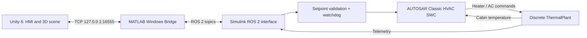

# AUTOSAR HVAC — Smart Automotive Climate Control Simulation

**MATLAB/Simulink · AUTOSAR Classic · ROS 2 · Unity 6**

Academic prototype of an automotive heating, ventilation and air-conditioning (HVAC) controller integrated with an interactive 3D driving demonstration.

> **Project status:** Functional academic prototype. The Unity weather scenarios and driving motion are visual simulations; outside temperature is **not yet connected** to the Simulink thermal plant. Not intended for deployment in a real vehicle.

## Overview

A driver adjusts a target cabin temperature from a Unity user interface. A local Windows TCP-to-ROS 2 bridge passes the setpoint to the Simulink model, which validates it, applies communication fallback logic, and feeds an AUTOSAR-style software component. This controller selects heating, cooling or hold using cabin-temperature feedback. Telemetry returns to Unity for visualization.

## Main capabilities

- AUTOSAR Classic-style HVAC control component with heating, cooling, maintain, and sensor-fault behavior.
- Thermal plant and closed-loop testing in Simulink.
- Setpoint validation in the configured **16–30 °C** interval and last-valid-value handling.
- Communication watchdog with a **22.5 °C** fallback setpoint when the input link is lost.
- ROS 2 telemetry and Windows-local TCP integration with an interactive Unity dashboard.
- Unity 6 driving visualization featuring an imported PHOENIX GT cockpit, weather scenarios and an HVAC state panel.

## Verified demonstrations

| Validation | Observed result |
|---|---|
| Unity → MATLAB setpoint | 24.00 °C received; TCP connected |
| Watchdog output → AUTOSAR model input | Direct Simulink connection verified |
| Unity → applied controller setpoint | 24.00 °C after fallback switch |
| Dynamic setpoint test | 20.00 °C applied; AC ON, heating OFF, maintain OFF |
| ROS 2 telemetry → MATLAB | Cabin-temperature received; one freshness observation was 0.03 s |
| Unity HMI telemetry | Cabin temperature and HVAC state displayed from running model |

These are **test observations**, not claims of measured end-to-end latency or automotive safety certification.

## Project files

- `Assets/`, `Packages/`, `ProjectSettings/`: Unity project. Open the latest scene under `Assets/Scenes` once the required imported assets are installed.
- `matlab/models/`: curated Simulink models (`.slx`).
- `matlab/bridge/`: Windows TCP / ROS 2 bridge MATLAB scripts (`.m`).
- `docs/`: architecture, validation evidence, third-party asset setup, and presentation outline.

The MATLAB directories should contain the source models and bridge code from the local project **before this repository is considered reproducible**.

## Requirements

- Unity Editor **6000.3.28f1**, Universal Render Pipeline.
- MATLAB/Simulink **R2022b** with the required ROS and AUTOSAR-related toolboxes used by the models.
- Windows host, localhost TCP port **16555**, ROS 2 domain **0** for the demonstrated setup.
- PHOENIX GT (XtreemARTS), downloaded independently from Unity Asset Store (see [asset setup](docs/ASSET_SETUP.md)).

## Run the demo

1. Install the Unity dependencies and third-party car model following [`docs/ASSET_SETUP.md`](docs/ASSET_SETUP.md).
2. Add the MATLAB bridge source directory to MATLAB's path.
3. Run `HVAC_Bridge_Start_ROS` **once** in MATLAB (do not relaunch while the TCP port is occupied).
4. Open Unity scene `HVAC_Drive_FINAL_V5.unity` and press Play.
5. Start the Simulink model `HVAC_ROS2_LinkWatchdog_v1` with simulation pacing enabled.
6. Change the target temperature in Unity; observe the applied setpoint, cabin temperature, and HVAC modes.
7. Use the Unity weather controls for the **visual** scenarios; they do not currently modify `ThermalPlant` outside temperature.

If a missing external asset appears, install the package in Unity and re-run the cockpit scene-builder integration if necessary. See [asset setup](docs/ASSET_SETUP.md).

## Known limitations

- Unity weather temperature currently affects only the scene/HMI visualization, not thermal plant physics.
- The car/road movement is a visual driving demonstration, not validated vehicle dynamics.
- No embedded ECU or physical vehicle was used.
- External Unity Asset Store assets are **not included in this repository**; each user must obtain them under the publisher's license.
- The prototype is not safety-certified or production automotive software.

## Documentation

- [Architecture and engineering assumptions](docs/ARCHITECTURE.md)
- [Validation checklist and evidence](docs/VALIDATION.md)
- [Asset installation and licensing](docs/ASSET_SETUP.md)
- [Academic presentation outline](docs/PRESENTATION_PLAN.md)
- [Windows Git publishing guide](PUBLISH_GUIDE.md)

## Author and credits

Academic project — Bilel Abid and Wissem Ammar.

Car model: **PHOENIX GT by XtreemARTS**, used under the publisher's Unity Asset Store license. AUTOSAR is a trademark of its respective owners; this project is an educational demonstration.

**License:** Original project code has no open-source license assigned yet. Third-party content remains governed by its own license. Add a license only after agreeing on permissions with all contributors.
